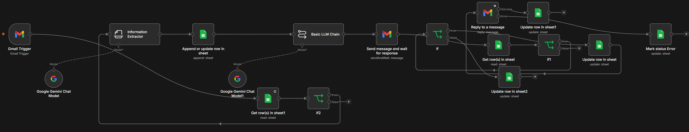

# AI Production Inquiry Agent

### Intelligent Email Intake, Client Management & Human-Approved AI Responses



An AI-powered workflow automation system built with **n8n, Google Gemini, Gmail, and Google Sheets** to streamline client inquiry management for creative and media production companies.

The system automatically processes incoming inquiries, extracts project requirements, generates personalized responses, and requests human approval before communicating with clients.

Built to demonstrate practical AI integration, business process automation, structured data extraction, and reliable human-in-the-loop workflows.

## Overview

Production companies regularly receive inquiries for commercial shoots, photography campaigns, branded content, and video production. Managing these inquiries manually involves reading emails, extracting requirements, tracking prospects, preparing responses, and following up.

This project automates much of that process while maintaining human oversight of client-facing communication.

### Key Features

- **Automated Email Intake:** Monitors Gmail for incoming production inquiries.
- **AI Information Extraction:** Uses Google Gemini to identify client details, project requirements, production dates, locations, and budgets.
- **Structured Lead Management:** Records inquiries in Google Sheets.
- **AI-Generated Responses:** Creates context-aware, professional reply drafts.
- **Human-in-the-Loop Approval:** Requires explicit approval before sending external emails.
- **Duplicate Detection:** Checks existing Gmail message IDs to reduce duplicate processing.
- **Status Tracking:** Tracks inquiries through Pending Approval, Sending, Sent, Rejected, and Error states.
- **Failure Handling:** Routes unsuccessful send operations through an error-status path.

Separate companion workflows provide error notifications and stuck-record monitoring.

## System Architecture

```text
Gmail Trigger
      |
      v
Google Sheets Duplicate Lookup
      |
      v
New Inquiry?
      |
      +--- No ---> Stop
      |
     Yes
      |
      v
Gemini AI Information Extraction
      |
      v
Google Sheets: Save Inquiry
      |
      v
Gemini AI: Generate Reply
      |
      v
Gmail: Request Human Approval
      |
      v
Approved?
      |
      +--- No ---> Update Status: Rejected
      |
     Yes
      |
      v
Verify Pending Approval Status
      |
      v
Update Status: Sending
      |
      v
Gmail: Reply to Original Email
      |
      +--- Failure ---> Update Status: Error
      |
    Success
      |
      v
Update Status: Sent
```

## Technology Stack

| Technology | Purpose |
|---|---|
| n8n | Workflow orchestration and business automation |
| Google Gemini | Information extraction and response generation |
| Gmail | Email monitoring, approvals, and replies |
| Google Sheets | Structured inquiry storage and status tracking |
| JSON | Structured data exchange and workflow configuration |

## Extracted Information

Each inquiry is stored using a consistent data structure.

| Field | Description |
|---|---|
| `email_id` | Original Gmail message identifier |
| `client_email` | Sender's email address |
| `client_name` | Client's name |
| `company_name` | Organization or brand |
| `project_type` | Commercial, photography, video, etc. |
| `project_description` | Summary of project requirements |
| `shoot_date` | Requested production date |
| `location` | Shoot location |
| `budget_amount` | Estimated budget |
| `budget_currency` | Currency associated with the budget |
| `status` | Current inquiry processing status |

## Human Approval and AI Safety

The automation deliberately separates AI-generated content from final client communication.

Google Gemini creates a proposed response using the extracted project details. The draft is then emailed to an internal reviewer.

The reviewer can approve or reject the proposed response.

Only approved messages proceed to the Gmail reply action, provided the inquiry still has an eligible status.

The AI is instructed not to make unsupported promises about pricing, availability, or confirmed bookings.

## Installation and Setup

### Prerequisites

- An n8n instance
- Gmail account with appropriate permissions
- Google Sheets account
- Google Gemini model access through a compatible n8n credential or AI Gateway
- An internal email address for reviewing proposed replies

### Configuration

1. Download the sanitized workflow JSON from this repository.
2. Import the JSON into your n8n workspace.
3. Configure your Gmail credentials.
4. Create a Google Sheet using the columns listed above.
5. Replace the spreadsheet placeholders and select the correct worksheet in every Google Sheets node.
6. Configure both Google Gemini Chat Model nodes.
7. Replace the internal approval email placeholder with your own address.
8. Review the workflow's conditions, field expressions, and response settings.
9. Configure a compatible error workflow if required.
10. Test the full process using email accounts you control before publishing.

**Important:** The workflow template does not include live credentials or personal configuration details.

## Testing and Validation

The workflow has been deployed and its primary approved-response path has been tested successfully using a controlled inquiry.

The confirmed test included:

- Receiving an inquiry through Gmail
- Extracting project information with Gemini
- Recording the inquiry in Google Sheets
- Generating a personalized response
- Delivering a human approval request
- Sending an approved reply
- Completing the inquiry's processing lifecycle

Duplicate detection was also tested separately.

Rejection, failed-send recovery, and companion alert workflows require further live validation before relying on them for business-critical communication.

## Companion Monitoring Workflows

The deployed system also includes two separate n8n workflows:

**Intake Error Alert**

Records workflow execution errors in an n8n data table and sends an internal notification.

**Intake Stuck Records Monitor**

Checks for inquiries that remain in Pending Approval or Sending longer than configured thresholds.

These companion workflows are not bundled in the main workflow JSON and must be configured separately.

## Limitations and Future Improvements

This project is designed as a portfolio-ready functional prototype.

Potential improvements include:

- Replacing Google Sheets with PostgreSQL for stronger transaction control and uniqueness constraints
- Adding timestamps for more accurate status monitoring
- Building a centralized lead management dashboard
- Supporting WhatsApp Business inquiries
- Adding automatic project categorization and priority scoring
- Improving multi-user approval and escalation processes
- Expanding automated test coverage

Google Sheets-based duplicate checks are not atomic, so overlapping executions may still create duplicate records.

## Security

The publicly shared workflow is a sanitized template.

Credential references, live spreadsheet identifiers, internal workflow identifiers, and personal configuration values have been removed or replaced with placeholders.

Users must configure their own accounts and credentials after importing the workflow.

## Project Status

**Deployed, functional prototype**

The core approved-email workflow has been demonstrated successfully. Additional reliability testing and production hardening remain possible improvements.

## Author

Developed as a practical AI automation and systems integration project.

## License

Add a license file if you choose to permit public reuse or modification of this workflow.
